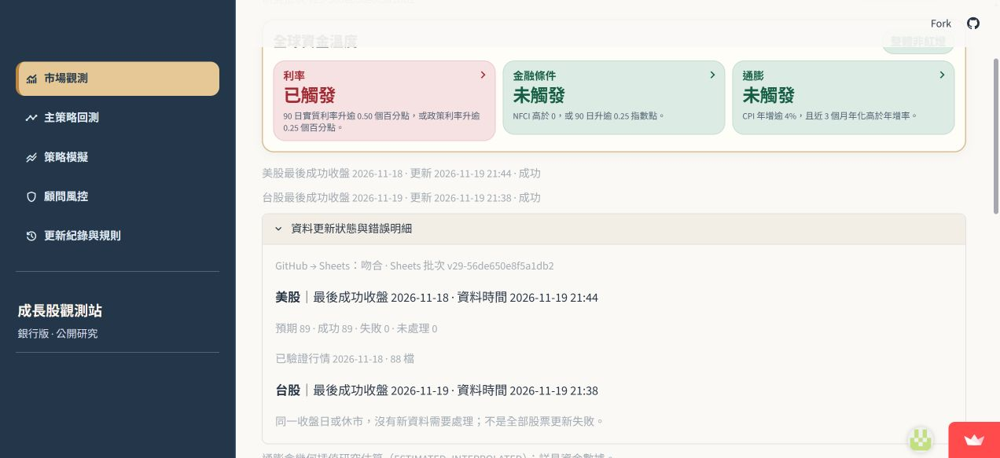

# 台美股更新與限流保護驗收

驗收日期：2026-11-19，Asia/Taipei。

## 最終排程與修改前比較

| 項目 | 修改前 | 最終設定 |
|---|---|---|
| 美股研究更新 | 週二至週六 06:17；備援仍在未合併 PR #22 | 原 06:17；07:17、08:17 有限備援 |
| 台股研究更新 | 週一至週五 16:30、17:30、18:30、21:27 | 維持原時段，以實際交易日為準 |
| Google Sheets 同步 | 每小時，讀完整 release；可能記錄 same_close | 每五分鐘只讀靜態 attempt.json；新成功批次才下載 release、驗證與寫入 |
| 同收盤日重跑 | 仍讀基準行情、總經，可能下載 ETF | 完整批次已發布即提前跳過，不呼叫行情、財報、ALFRED，不重算研究池 |
| 暫時性故障重試 | 本次修復初版曾設三次、45/90 秒 | 最多一次額外重試，等待 120 秒；僅限 timeout、傳輸或 HTTP 5xx |

完整更新從未設為每五分鐘。唯一五分鐘觸發器為 Apps Script `syncBankResearch`，其專案名稱仍是「成長股觀測站｜私人研究同步排程」，實際 SOURCE 明確指向銀行版 research-data，不讀私人持倉。

## 五分鐘檢查會呼叫什麼

- 一次 `raw.githubusercontent.com/.../research-data/attempt.json` 靜態狀態 GET，使用五分鐘快取鍵及 ETag 條件讀取。
- 批次未變：不讀 Sheets、不寫 Sheets、不下載完整研究快照。
- 有新成功批次：讀一次靜態 release.json，核對批次一致、完整性及 SHA-256，再整批寫入 Sheets。
- 不呼叫 Yahoo、SEC、FinMind、FRED/ALFRED、TWSE 或 TPEx；不啟動 GitHub Actions。
- 改用靜態檔後，五分鐘檢查不再依賴 GitHub REST API。驗收中曾觀測其公開 REST 配額限制，舊版冷卻立即生效，之後改用上述靜態狀態設計。

## 重疊與限流防護

- 完整研究與會寫同一資料分支的官方公告存檔工作共用 `research-publish` concurrency，`cancel-in-progress: false`，不平行抓取與發布。
- 官方 TWSE/TPEx 存檔原有 08:45、21:45 排程維持；成功研究後的額外觸發只接受真正完成 80 檔台股新行情的發布，不因美股備援或 same_close 重複抓官方端點。
- 績效續算使用另一序列鎖，但讀取已保存的行情與總經輸入，不重新下載上述行情來源。
- HTTP 429：來源至少冷卻一小時，若 Retry-After 更長則採更長時間。403：至少冷卻六小時。冷卻時間寫入市場嘗試紀錄，跨下一個排程仍生效。
- FinMind HTTP 200 但 JSON 回報 402/429 或配額上限，也會開啟同一來源停止請求保護。
- 估值、財報、行情一致性或其他驗證失敗不連續重跑整個研究池，保留上個完整批次及錯誤明細，等待後續既定時段。
- Google 靜態來源若回報 429/403，五分鐘檢查也停止一小時。來源端仍可能自行限流；系統不承諾完全不發生來源限制。

## 通膨補值

來源版本：ALFRED 2026-11-18，各序列分開，單位皆為 1982–1984=100。

| 序列 | 季調 | 2025/09 官方 | 2025/11 官方 | 2025/10 幾何插值 |
|---|---|---:|---:|---:|
| CPIAUCSL | SA | 324.245 | 325.063 | 324.6537423702 |
| CPIAUCNS | NSA | 324.800 | 324.122 | 324.4608229047 |
| CPILFESL | SA | 330.418 | 331.043 | 330.7303523628 |
| CPILFENS | NSA | 330.804 | 330.425 | 330.6144456917 |

每列公式：sqrt(同序列 9 月指數 × 同序列 11 月指數)。

原始 CSV、官方缺值與端點存於 `data/cpi-research-2025-10.json`，各列 source 包含可重現的 ALFRED URL。Sheets「CPI_2025_10_估計補值」已更新四序列與公式。

實際總經引擎使用 CPIAUCSL；核心 CPI 等其餘三序列不被擅自加入選股規則。引擎即時研究可使用 `ESTIMATED_INTERPOLATED` 補值，保留端點、季調屬性、來源版本、取得及可得時間。歷史計算預設禁用此次補值；含估算的即時輸入不得被標成已驗證的正式歷史重播輸入。

目前重算 CPI 年增率約 3.9495%，利率 1、金融條件 0、通膨 0，資金溫度 1 分、非紅燈。

## 已定位的問題

1. Sheets 的舊補值只是展示分頁，總經引擎仍直接讀有缺口的官方 ALFRED CSV。
2. 同收盤日直接跳過發布，使通膨修正不能刷新當日已發布快照；現支援必要的總經修復，修復完成後的同日備援零抓取。
3. 2026-11-18 台股曾因 2344、5434 主來源未提供最新完整行情、備援期間涉及除權息事件，正確保留舊批次；另一次失敗為來源 timeout，未放寬驗證。
4. 美股備援與監控修正原停在未合併 PR #22；本次直接部署正式主分支。近期亦觀察到排程延遲，GitHub 平台實際排隊時間仍無法保證精準到分鐘。
5. 舊 Sheets 同步依賴最新 attempt.status 為 published，若已被 same_close 覆蓋，可能漏收先前的成功批次。現以實際成功封套批次識別、保留官方資料並避免重複寫入。

## 實際驗收

- 台股實際更新：[44535444608](https://github.com/monstervincentw-glitch/growth-observatory-bank/actions/runs/44535444608)，成功，80 檔，收盤 2026-11-19。
- 美股同日補值重算：[44535822860](https://github.com/monstervincentw-glitch/growth-observatory-bank/actions/runs/44535822860)，成功，研究池 89 檔，收盤 2026-11-18。88 檔當日有效行情；ROKU 為既有 11/09 停止交易事件，保留其原有事件資料，未製造後續行情。
- 安全同日重跑：[44537369042](https://github.com/monstervincentw-glitch/growth-observatory-bank/actions/runs/44537369042)，成功。日誌明確記錄不呼叫行情、財報、FRED/ALFRED、不重算研究池；後續 `SHEETS_VERIFIED` 通過。
- GitHub、Sheets bank_snapshot 與正式 Streamlit 同批：`v29-56de650e8f5a1db2`。
- SHA-256：`7294d67c63e6d650d508199197635734a2b4169ae3a5c3bd24ce87b3ecd9a2ca`。
- Apps Script 現場執行新成功批次同步通過，再執行相同批次無新增寫入；已核對觸發器為每 5 分鐘。
- 自動測試：46 個 Node 測試、11 個相關 Python 測試通過，涵蓋季調分離、補值與 PIT 隔離、夏令時間、同日零網路請求、相同批次零 Sheets 操作、HTTP 429 與 FinMind JSON 配額限制。
- 正式網站顯示兩市場成功時間及 GitHub → Sheets 吻合；估算標記可見。

## 下次與待驗證項目

- 下次美股原定排程：2026-11-20 06:17 台北時間；07:17、08:17 有限備援。
- 下次台股原定排程：2026-11-20 16:30；17:30、18:30、21:27 備援。
- 下一交易日的自然排程觸發、來源到齊時點及跨休市日行為仍須由後續自動執行紀錄驗證，不能以本次即時實測宣稱永久穩定。
- 既有隔離台股歷史重建工作仍有缺少 2026-11-17 重建輸入的錯誤。本次未改正式回測、歷史帳戶、選股規則、權重、私人投資組合或 FCN。
