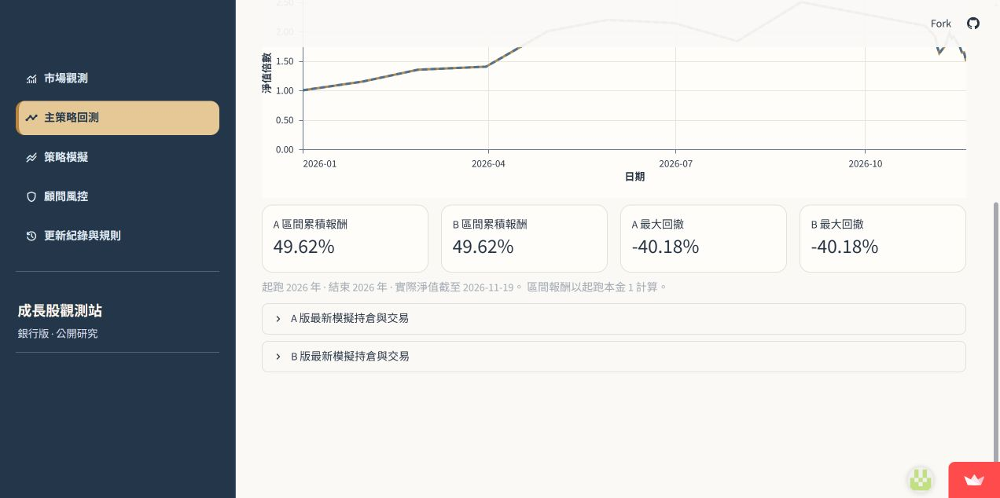

# 台股 A/B 逐日續算修復與驗收

日期：2026-11-19（台北時間）。正式策略最新續算日：2026-11-19。

## 根本原因及兩條管線

1. 隔離重建輸入原定範圍為 11/04～11/16，包含 80 檔、9 個日期。計算程式卻使用最新研究快照作為終點；快照更新到 11/17 以後，就錯誤要求範圍外的重建輸入，導致 `Missing Taiwan reconstructed daily input 2026-11-17`。現將隔離計算上限明確綁定其資料目錄的 `through`。它仍保持研究標記，未冒充正式績效。
2. 正式 A/B 管線已有 11/17 的原生 `observed-primary-inputs/TW/2026-11-17.json` 與 22 組帳戶檢查點，並非缺少同一份資料。
3. 11/18、11/19 的完整行情與當時可用的財報版本已保存於 `market-observations/TW`。但即時研究的日頻總經未知狀態、以及禁止事後估算進入歷史輸入的保護，讓這兩天未產生可供正式續算讀取的決策輸入。
4. 原 A/B 計算核心實際使用的是週頻 ALFRED 模型。這兩天皆應使用原 11/13 版本。其分數範圍為 0～1：原進場門檻 ≤1、出場門檻 ≥2，所有可能分數給出相同門檻判斷。使用既有 `replay_funding` 函式驗證，未變更門檻，也未把代理分數冒稱官方確切分數。

## 已補齊的資料

| 日期 | 原生封存 | 處理結果 |
|---|---|---|
| 11/17 | 正式決策輸入與帳戶檢查點已有 | 完整保留，作為續算起點 |
| 11/18 | 80 檔行情、財報有效版本及技術資料已有 | 逐檔核對財報可得時間、原數值版本、行情日期及調整價格，配合原週頻總經，恢復完整輸入 |
| 11/19 | 同上，80 檔完整 | 同上，恢復完整輸入 |

全程只使用既有 GitHub 封存，未重抓股價、財報或總經，未重做 CPI 插值。

兩天的正式輸入已隨績效發布保存於：

- `performance-data/primary/TW/input-archive/2026-11-18.json.gz`
- `performance-data/primary/TW/input-archive/2026-11-19.json.gz`
- 稽核摘要：`performance-data/primary/TW/input-recovery.json`

每份輸入保留實際恢復時間、原始觀測時間、財報版本、首次驗證及可使用時間、來源檔案 SHA-256、原總經週版本、門檻分數範圍。不把恢復時間回填成過去已實際取得的時間。

原始行情來源摘要：

- 11/18 observation SHA-256：`52e64e3978ed38fc095834db5dbfe647e106195d8b7e1b444c48b8e7c81fd36c`
- 11/19 observation SHA-256：`a66d602e15ee23d0bec5c73b347f601361936f0bcbf1d023261d0b9e30c83d33`

正式發布輸入 SHA-256：

- 11/18：`f45b20cda3121d266f5e4196c1af157a52c4f46f77428f8d2841849929fe041c`
- 11/19：`515cf2d04f0679c9e32212b63fd546c23ce453429b7f360bf0bc82b66449639a`

## 計算及不可變歷史驗收

- 原封不動沿用 A/B 核心、評分權重、財報條件、進出場、下一交易日開盤執行與交易成本。
- 正式從 11/17 檢查點逐日續算 11/18、11/19，不跨過缺失日期。
- 22 組帳戶（2016～2026 起跑，各 A/B）的既有淨值曲線前綴完全相等，新增日期恰為 11/18、11/19。
- 舊交易帳本逐檔位元組比對完全相同；原始研究封存與來源摘要亦未更動。
- 一次續算兩天與分成兩次逐日續算，22 組帳戶的淨值、現金、部位、交易數及累積報酬一致。
- 現金加持倉市值等於帳戶淨值；不存在同日訊號提前成交或重複交易。
- 已核對 `performance/primary.py`、`primary_engine/tw/backtest.py`、`primary_engine/tw/config.json`、`engine/equity_ab.py` 位元組均未修改。
- 6 個新增保護測試通過，涵蓋財報數值版本不一致、財報／總經過晚可得、行情缺漏／未來資料及原門檻可判定範圍。

2026 年起跑模擬帳戶的最新結果：

| 日期 | A 淨值倍數 | B 淨值倍數 |
|---|---:|---:|
| 11/17（原封存，保留） | 1.6397179893528353 | 1.6397179893528353 |
| 11/18 | 1.6448770047598515 | 1.6448770047598515 |
| 11/19 | 1.4961729271453720 | 1.4961729271453720 |

11/19 兩版皆為累積報酬約 +49.62%、9 檔持倉、現金 0，淨值 NT$4,488,518.78（起始本金 NT$3,000,000）。

11/18 依 11/17 訊號，兩版皆依原核心賣出 3533、買入 5274；11/19 無新增成交。此為策略回測模擬紀錄，未執行任何實際帳戶交易。

## 正式部署證據

- 程式修復：[8f7290d](https://github.com/monstervincentw-glitch/growth-observatory-bank/commit/8f7290d7558434fec2119d3253510d39e9895cc8)
- 正式績效 Actions：[44541488803](https://github.com/monstervincentw-glitch/growth-observatory-bank/actions/runs/44541488803)，成功。
- 正式績效發布：[d4086d2](https://github.com/monstervincentw-glitch/growth-observatory-bank/commit/d4086d2)
- 隔離重建 Actions：[44541488799](https://github.com/monstervincentw-glitch/growth-observatory-bank/actions/runs/44541488799)，成功，維持 11/16 範圍與未完成歷史數值版本核實標記。
- `performance-data/status.json`：TW=`VERIFIED`、through=`2026-11-19`、cohorts=22、input_recovery.gaps={}。
- 正式銀行版已切換台股並實際核對淨值截至 11/19、A/B +49.62%、最新持倉日期與兩筆交易。

## 後續自動保存與剩餘限制

- 既有收盤更新繼續保存逐日 80 檔行情、財報當時有效版本與原始資料；排程未修改。
- 原有「銀行版每日績效續算」在執行 A/B 前，自動檢查並離線恢復缺少的決策輸入，完整壓縮輸入及來源摘要隨績效一起保存。
- 若行情缺漏、財報過晚可得、數值版本衝突、原週頻總經無法判定門檻，或已保存輸入來源被改動，會記錄具體日期與原因，保留最後可驗證檢查點，不跳日或製造交易。
- 本次 11/18、11/19 正式台股續算資料缺口均已清除，11/17 原檢查點完全保留。
- 更早的隔離研究仍未完成所有歷史供應商數值與原財報 PDF 的逐項版本核實，維持非正式研究標示；沒有升格或重寫正式歷史。
- 既有 ETF 輸入價格銜接驗證失敗仍保留原狀，不屬本次台股 A/B 修復範圍。
